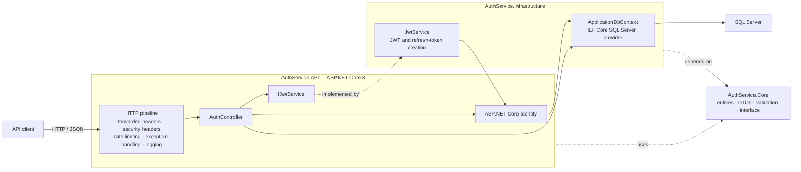
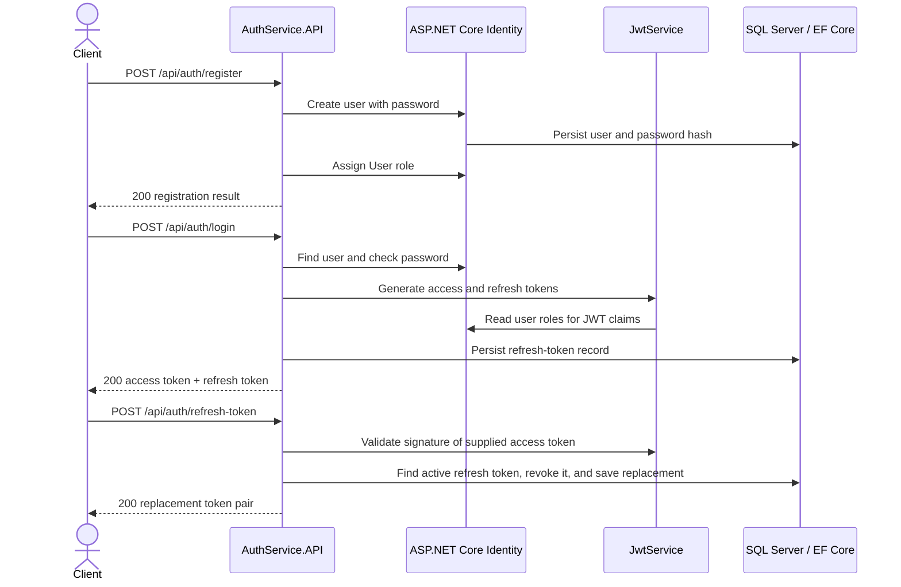
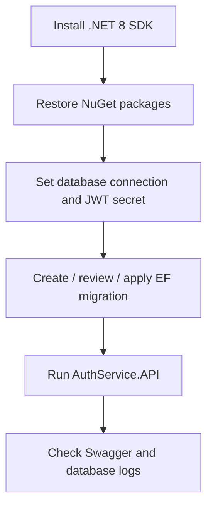

# Auth Service


An ASP.NET Core Web API starter for account registration, password authentication,
JWT access tokens, and refresh-token rotation. It uses ASP.NET Core Identity and
Entity Framework Core with SQL Server.

> **Project status:** This repository contains an application foundation, not a
> production-ready identity platform. It now includes an initial EF Core
> migration, but has no automated test projects, CI/CD pipeline, container or
> Kubernetes deployment files, health checks, or license. Important security
> and operational limitations are called out below. Review and address them
> before production use.

## Contents

- [Overview](#overview)
- [Screenshots](#screenshots)
- [Architecture](#architecture)
- [Technology stack](#technology-stack)
- [Repository structure](#repository-structure)
- [Requirements](#requirements)
- [Installation and first run](#installation-and-first-run)
- [Configuration and environment variables](#configuration-and-environment-variables)
- [Local development](#local-development)
- [API reference](#api-reference)
- [Database](#database)
- [Security](#security)
- [Testing and quality](#testing-and-quality)
- [CI/CD and releases](#cicd-and-releases)
- [Deployment and operations](#deployment-and-operations)
- [Monitoring and observability](#monitoring-and-observability)
- [Performance and scaling](#performance-and-scaling)
- [Maintenance](#maintenance)
- [Contributing](#contributing)
- [FAQ and troubleshooting](#faq-and-troubleshooting)
- [Roadmap and current limitations](#roadmap-and-current-limitations)
- [License](#license)
- [Support and vulnerability reports](#support-and-vulnerability-reports)
- [Appendix: useful commands and glossary](#appendix-useful-commands-and-glossary)

## Overview

### Purpose

Auth Service provides a centralized HTTP API for basic identity operations. It
is intended as a starting point for applications that need user accounts,
credential verification, role claims, signed bearer tokens, and revocable
sessions represented by refresh tokens.

### Problem it addresses

Applications often need a common place to manage credentials and establish
authenticated requests. This project brings account handling and token issuance
into one ASP.NET Core service backed by Identity and SQL Server, rather than
requiring each client to implement those operations itself.

### Key capabilities

- Register a user and assign the default `User` role.
- Verify email/password credentials and issue a signed JWT and refresh token.
- Rotate a refresh token and revoke the token it replaces.
- Revoke a refresh token at logout.
- Change the authenticated user's password.
- Validate request DTOs with data annotations and a birth-date validator.
- Apply configured IP-based in-memory rate limits.
- Add security response headers, structured request logging, and exception
  handling middleware.
- Browse the API with Swagger UI in the Development environment.

### Intended users and use cases

- Developers evaluating or extending an ASP.NET Core identity API foundation.
- Internal applications that need a small authentication service prototype.
- Teams learning how Identity, EF Core, JWT bearer authentication, and refresh
  token persistence fit together.

The service is an API, not a web application: it has no frontend, user-facing
screens, social sign-in, federation, or client SDK.

## Screenshots

There are no screenshot assets in the repository. The API's interactive
documentation is Swagger UI at `/swagger` when the service is running in
Development.

> **Screenshot placeholder:** Add a reviewed Swagger UI image here when a
> screenshot asset is available.

## Architecture

### High-level view



### Components

| Component | Responsibility |
| --- | --- |
| `AuthService.API` | HTTP routes, dependency injection, authentication configuration, Swagger, middleware, startup role seeding, and application configuration. |
| `AuthService.Core` | Identity entities, request/response DTOs, validation, and the `IJwtService` abstraction. |
| `AuthService.Infrastructure` | `ApplicationDbContext` EF Core mapping and the `JwtService` implementation. |
| SQL Server | Stores Identity data, user contact/address records, and refresh-token records. |

The API references Core and Infrastructure. Infrastructure references Core.
Core has no project references. ASP.NET Core's built-in dependency injection
registers the JWT implementation as a scoped service.

### Request and token flows



### Design and operational considerations

- **Layered separation:** HTTP concerns, domain-facing types, and persistence /
  token implementation are in separate projects.
- **Dependency injection:** Controller dependencies and the JWT service are
  supplied by ASP.NET Core DI.
- **Middleware pipeline:** Forwarded headers, exception handling, response
  security headers, Serilog request logging, rate limiting, authentication, and
  authorization are registered in `Program.cs`.
- **Stateless access tokens, stateful refresh tokens:** JWTs are validated
  locally; refresh tokens are looked up and rotated in SQL Server.
- **Scale-out limitation:** IP rate-limit counters use in-memory storage, so
  they are per process and are not shared across replicas. Refresh-token state
  is in SQL Server and can be shared if all instances use the same database and
  token configuration.
- **Security boundary:** Clients must use HTTPS outside isolated development.
  Configure trusted proxy forwarding deliberately; do not trust arbitrary
  forwarded headers from untrusted internet clients.

## Technology stack

| Area | Technology currently present |
| --- | --- |
| Backend / API | .NET 8, ASP.NET Core Web API |
| Identity | ASP.NET Core Identity, Identity EF Core stores |
| Authentication | JWT bearer authentication, `System.IdentityModel.Tokens.Jwt`, Microsoft IdentityModel token validation |
| Data access | Entity Framework Core 8 |
| Database provider | SQL Server; LocalDB is the checked-in development default |
| API documentation | Swashbuckle / Swagger UI |
| Rate limiting | AspNetCoreRateLimit with in-memory counters |
| Logging | Serilog ASP.NET Core, console sink, rolling file sink |
| Frontend | None |
| Infrastructure as code | None found |
| Containers / orchestration | No Dockerfile, Compose file, or Kubernetes manifests found |
| CI/CD | No pipeline definitions found |
| Tests | No test project or test framework configured in the solution |
| Metrics / tracing | No metrics or distributed tracing provider configured |
| External integrations | SQL Server is the configured data service; no email, OAuth provider, or webhook integration is implemented |

Package versions are declared in the three project files. The projects target
`net8.0`.

## Repository structure

```text
.
├── .gitignore
├── README.md
├── AuthService.slnx
├── AuthService.API/
│   ├── AuthService.API.csproj
│   ├── Program.cs
│   ├── AuthService.API.http
│   ├── appsettings.json
│   ├── appsettings.Development.json
│   ├── Properties/
│   │   └── launchSettings.json
│   ├── Controllers/
│   │   └── AuthController.cs
│   ├── Exceptions/
│   │   └── ApiExceptions.cs
│   ├── Middleware/
│   │   ├── ExceptionHandlingMiddleware.cs
│   │   └── SecurityHeadersMiddleware.cs
│   └── Models/
│       └── ApiResponse.cs
├── AuthService.Core/
│   ├── AuthService.Core.csproj
│   ├── DTOs/
│   │   ├── AuthResponse.cs
│   │   ├── ChangePasswordRequest.cs
│   │   ├── ForgotPasswordRequest.cs
│   │   ├── LoginRequest.cs
│   │   ├── RefreshTokenRequest.cs
│   │   ├── RegisterRequest.cs
│   │   └── ResetPasswordRequest.cs
│   ├── Entities/
│   │   ├── ApplicationRole.cs
│   │   ├── ApplicationUser.cs
│   │   ├── RefreshToken.cs
│   │   ├── UserAddress.cs
│   │   └── UserPhone.cs
│   ├── Interfaces/
│   │   └── IJwtService.cs
│   └── Validators/
│       └── DateValidator.cs
└── AuthService.Infrastructure/
    ├── AuthService.Infrastructure.csproj
    ├── Data/
    │   ├── Migrations/
    │   │   ├── 20261020112409_InitialCreate.cs
    │   │   ├── 20261020112409_InitialCreate.Designer.cs
    │   │   └── ApplicationDbContextModelSnapshot.cs
    │   └── ApplicationDbContext.cs
    └── Services/
        └── JwtService.cs
```

### Important files

- `AuthService.slnx` lists the API, Core, and Infrastructure projects.
- `AuthService.API/Program.cs` configures services and middleware, applies EF
  Core migrations at startup, and seeds the default roles.
- `AuthService.API/Controllers/AuthController.cs` implements the five current
  authentication routes.
- `AuthService.API/appsettings.json` contains the default connection string,
  JWT settings, rate-limit rules, and Serilog levels.
- `AuthService.API/Properties/launchSettings.json` defines local HTTP/HTTPS
  launch profiles and ports.
- `AuthService.API/AuthService.API.http` is an editor HTTP request file. Its
  current sample still refers to `/weatherforecast`, which is not an
  implemented endpoint.
- `AuthService.Infrastructure/Data/ApplicationDbContext.cs` maps Identity and
  application entities to database tables.
- `AuthService.Infrastructure/Services/JwtService.cs` creates JWTs and random
  refresh-token values.
- `.gitignore` excludes build output, local settings, logs, and database files;
  EF Core migration source is kept in version control.

The `bin/`, `obj/`, and runtime `logs/` directories may appear locally but are
generated artifacts and are not part of the source layout.

## Requirements

### Required

- .NET 8 SDK.
- SQL Server accessible to the API. The checked-in default uses SQL Server
  LocalDB and is intended for Windows development.
- Network access to restore NuGet packages on first build.

### Recommended for development

- Visual Studio, Visual Studio Code with C# tooling, or another .NET-capable
  editor.
- `dotnet-ef` 8.x for authoring EF Core migrations (not required merely to run
  the API if migrations have already been added to the project).
- A SQL client for examining the database.

There is no frontend toolchain, JavaScript package manager, Python runtime,
Docker, or Kubernetes requirement for the current source.

## Installation and first run

### 1. Restore and build

Run from the repository root:

```powershell
dotnet --info
dotnet restore .\AuthService.slnx
dotnet build .\AuthService.slnx
```

### 2. Configure secrets and database access

Set the connection string and a unique JWT signing secret. See
[Configuration and environment variables](#configuration-and-environment-variables).
Do not use the checked-in example signing key outside local-only development.

### 3. Create and apply the database schema

The initial migration, `20261020112409_InitialCreate`, creates the Identity and
application tables. `Program.cs` calls `MigrateAsync()` during startup and then
seeds the `Admin`, `User`, and `Manager` roles. The startup code catches and
logs migration errors, then continues starting the web server; a successful
HTTP startup therefore does not prove the database is ready.

To apply it to another configured database:

```powershell
dotnet ef database update `
  --project .\AuthService.Infrastructure\AuthService.Infrastructure.csproj `
  --startup-project .\AuthService.API\AuthService.API.csproj
```

To create a later schema migration, use the same project/startup-project
arguments with `dotnet ef migrations add <MigrationName> --output-dir
Data\Migrations`. Review and commit the migration and model snapshot.

For production, prefer reviewed migration scripts or a controlled deployment
step instead of applying schema changes implicitly during application startup.

### 4. Run the API

```powershell
dotnet run --project .\AuthService.API\AuthService.API.csproj --launch-profile http
```

The `http` profile listens on `http://localhost:5170`. The `https` profile
listens on `https://localhost:7282` and `http://localhost:5170`. In Development,
open [http://localhost:5170/swagger](http://localhost:5170/swagger).

### 5. Verify startup

```powershell
Invoke-WebRequest http://localhost:5170/swagger/index.html
```

Swagger returning HTTP 200 verifies the HTTP application is responding. Also
check the console and `AuthService.API/logs/` for database migration errors;
database-backed features require a valid schema and connection.

### Setup flow



## Configuration and environment variables

ASP.NET Core loads `appsettings.json`, the environment-specific appsettings
file, and environment variables. Use double underscores (`__`) to represent
configuration nesting in environment-variable names. Environment variables
override JSON values.

| Setting / environment variable | Required | Default / example | Purpose and security notes |
| --- | --- | --- | --- |
| `ConnectionStrings__DefaultConnection` | Yes for database features | LocalDB connection in `appsettings.json` | SQL Server connection string. Treat credentials as secrets. Use a least-privilege database identity in hosted environments. |
| `Jwt__SecretKey` | Yes | Checked-in development placeholder; replace it | HMAC signing key. Supply a unique cryptographically random secret of at least 32 bytes. Store it in a secret manager; never commit a production key. Changing it invalidates previously issued access tokens. |
| `Jwt__Issuer` | Yes for a well-defined token issuer | `AuthService` | Expected JWT issuer. Keep issuance and validation settings consistent. |
| `Jwt__Audience` | Yes for a well-defined token audience | `AuthServiceClient` | Expected JWT audience. Configure only the intended consumers. |
| `Jwt__AccessTokenExpirationMinutes` | No | `15` | Access-token lifetime read by `JwtService`. The login response currently reports a hard-coded 15 minutes, so keep this setting at 15 unless that response behavior is corrected. |
| `ASPNETCORE_ENVIRONMENT` | No | Launch profiles set `Development` | Controls environment-specific configuration and Swagger availability. Use `Production` in production; avoid exposing development exception details. |
| `IpRateLimiting__...` | No | See rate-limit section in `appsettings.json` | AspNetCoreRateLimit settings; nested arrays can be overridden using indexed environment keys. Prefer managing complex rule sets in protected deployment configuration. |
| `Serilog__MinimumLevel__Default` | No | `Information` | Default minimum log level. Avoid raising verbosity where sensitive request data could be exposed. |
| `Serilog__MinimumLevel__Override__Microsoft` | No | `Warning` | Microsoft framework log level override. |
| `Serilog__MinimumLevel__Override__System` | No | `Warning` | System log level override. |
| `AllowedHosts` | No | `*` | ASP.NET Core host filtering. Restrict to expected hostnames in deployment. |

For PowerShell local development:

```powershell
$env:ConnectionStrings__DefaultConnection = "Server=localhost;Database=AuthServiceDb;Trusted_Connection=True;TrustServerCertificate=True"
$env:Jwt__SecretKey = "<replace-with-a-unique-random-secret-of-at-least-32-bytes>"
$env:Jwt__Issuer = "AuthService"
$env:Jwt__Audience = "AuthServiceClient"
$env:ASPNETCORE_ENVIRONMENT = "Development"
dotnet run --project .\AuthService.API\AuthService.API.csproj
```

Environment variable values set this way apply only to the current PowerShell
process and its child processes. Production secrets should come from the
deployment platform's secret store, not from a checked-in file or command
history.

### Rate-limit configuration

The current JSON config enables endpoint rate limiting, returns HTTP `429` when
limited, and defines:

| Rule | Limit |
| --- | --- |
| All endpoints | 60 requests per minute per client IP |
| `POST:/api/auth/login` | 5 requests per minute per client IP |

The counters use in-memory storage and reset when the process restarts. Limits
are not coordinated across multiple replicas.

### Feature flags and runtime settings

No feature-flag system is present. The application configures JWT parameters,
Identity password/user settings, rate limits, logging, forwarded headers, and
development Swagger directly in `Program.cs` and JSON settings.

## Local development

### Workflow

1. Create or select a SQL Server database and configure the connection string.
2. Ensure a tracked EF migration exists and apply it.
3. Set the Development environment and a local JWT secret.
4. Run `dotnet watch --project .\AuthService.API\AuthService.API.csproj`.
5. Use Swagger UI or an HTTP client to exercise `/api/auth` routes.
6. Run `dotnet build .\AuthService.slnx` after changes.

`dotnet watch` enables .NET hot reload where supported by the edited code. No
custom watch configuration is included.

### Debugging

- Set `ASPNETCORE_ENVIRONMENT=Development` for the Development launch profile.
- Use the debugger's ASP.NET Core launch configuration to attach to
  `AuthService.API`.
- Inspect console output and rolling files under `AuthService.API/logs/`.
- Check the SQL Server connection and migration state separately from the HTTP
  process; startup currently logs migration exceptions and continues.
- Swagger is registered only in Development.

### Configuration precedence

Environment variables override appsettings values. User Secrets are not wired
explicitly by the project, but can be enabled through standard ASP.NET Core
development hosting if desired. Do not use committed JSON settings for
credentials.

## API reference

Base route: `/api/auth`. JSON is used for request and response bodies. The
controller has `[ApiController]`, so invalid annotated DTOs are rejected by
ASP.NET Core model validation before the action executes.

### Authentication and authorization

- Public routes: registration, login, refresh, logout.
- Protected route: change password, requiring
  `Authorization: Bearer <access-token>`.
- Access tokens are HMAC-SHA256 JWTs with subject, email, username, `userId`,
  token ID, and Identity role claims.
- Identity is configured to require unique email and, for passwords, uppercase,
  lowercase, digit, and a minimum length of six characters. Registration and
  password-change DTOs impose the stricter minimum of eight and additionally
  require a character from `@$!%*?&`.
- Email confirmation is disabled for sign-in.
- `LoginRequest.RememberMe` is accepted but is not used by the current login
  action.

### Endpoints

| Method | Path | Auth | Purpose |
| --- | --- | --- | --- |
| `POST` | `/api/auth/register` | Public | Create a user and assign the `User` role. |
| `POST` | `/api/auth/login` | Public | Check credentials and issue access and refresh tokens. |
| `POST` | `/api/auth/refresh-token` | Public | Validate the supplied token pair, revoke the old refresh token, and issue a replacement pair. |
| `POST` | `/api/auth/logout` | Public | Revoke the refresh token supplied as a JSON string. |
| `POST` | `/api/auth/change-password` | Bearer JWT | Change the authenticated user's password. |

There are no implemented forgot-password or reset-password routes, despite
request DTOs for those future flows.

### Register

```http
POST /api/auth/register
Content-Type: application/json
```

```json
{
  "firstName": "Ada",
  "lastName": "Lovelace",
  "username": "ada",
  "email": "ada@example.com",
  "password": "StrongPass1!",
  "confirmPassword": "StrongPass1!"
}
```

`middleName` and `profileURL` are present on the request DTO but are not currently
copied to the user entity by the registration action. Birth dates in the future
are rejected. A successful action returns HTTP 200:

```json
{
  "message": "User registered successfully",
  "userId": "00000000-0000-0000-0000-000000000000"
}
```

### Login

```http
POST /api/auth/login
Content-Type: application/json
```

```json
{
  "email": "ada@example.com",
  "password": "StrongPass1!"
}
```

Success returns HTTP 200 with this shape:

```json
{
  "userId": "00000000-0000-0000-0000-000000000000",
  "userName": "ada",
  "email": "ada@example.com",
  "roles": ["User"],
  "accessToken": "<signed-jwt>",
  "refreshToken": "<opaque-random-token>",
  "expiresAt": "2026-10-20T11:15:00Z"
}
```

The expiry timestamp is generated as UTC now plus 15 minutes in the controller,
independent of `Jwt:AccessTokenExpirationMinutes`.

### Refresh

Send both the expired access token and current refresh token:

```http
POST /api/auth/refresh-token
Content-Type: application/json
```

```json
{
  "accessToken": "<expired-access-token>",
  "refreshToken": "<current-refresh-token>"
}
```

Success returns:

```json
{
  "accessToken": "<replacement-signed-jwt>",
  "refreshToken": "<replacement-opaque-token>"
}
```

The previous refresh-token record is marked revoked. The implementation
validates the supplied access-token signature while allowing an expired token
for this flow. In this refresh-specific validation path, issuer and audience
validation are also disabled, and the code does not require the access token to
actually be expired. Do not treat refresh validation as equivalent to normal
bearer authentication; see [Security](#security).

### Logout

The action binds the request body directly to a string, so send a JSON string
(not an object):

```http
POST /api/auth/logout
Content-Type: application/json
```

```json
"<refresh-token>"
```

The action revokes a matching active token and returns
`{"message":"Logged out successfully"}`. Logout currently does not require an
access token.

### Change password

```http
POST /api/auth/change-password
Authorization: Bearer <access-token>
Content-Type: application/json
```

```json
{
  "currentPassword": "StrongPass1!",
  "password": "NewStrongPass2!",
  "confirmPassword": "NewStrongPass2!"
}
```

### Error responses and status codes

The API currently has a mix of response shapes: Identity errors are returned
as arrays, action errors as objects, model-state errors use ASP.NET Core's
automatic API-controller response, and the exception middleware returns the
`ApiResponse<T>` envelope. Clients should use HTTP status codes as the primary
signal and tolerate these different bodies.

| Status | Meaning in current routes |
| --- | --- |
| `200` | Operation succeeded. |
| `400` | Invalid DTO or rejected Identity operation, such as weak password. |
| `401` | Invalid credentials, invalid/expired token, blocked account, or missing authorization. |
| `404` | Authenticated user was not found during password change. |
| `429` | Configured rate limit exceeded. |
| `500` | Unexpected controller failure; the database may also be unavailable. |

No webhooks are implemented.

## Database

### Provider and schema

The configured provider is SQL Server. `ApplicationDbContext` inherits from
`IdentityDbContext<ApplicationUser, ApplicationRole, Guid>`, uses GUID identity
keys, and maps Identity tables to these explicit names:

| Table | Entity / purpose |
| --- | --- |
| `Users` | `ApplicationUser` plus ASP.NET Core Identity user fields. |
| `Roles` | `ApplicationRole` plus Identity role fields. |
| `UserRoles` | User-to-role assignments. |
| `UserClaims` | Identity user claims. |
| `UserLogins` | External login records; no external login flow is implemented. |
| `RoleClaims` | Role claims. |
| `UserTokens` | Identity user tokens. |
| `UserPhones` | User phone contact records. |
| `UserAddresses` | User address records. |
| `RefreshTokens` | Refresh-token value, expiry, issue/revocation metadata, and owner. |

### Relationships and indexes

- A user has many phone records, addresses, and refresh-token records.
- Each phone, address, and refresh token belongs to one user.
- These relationships use cascading delete behavior.
- Identity configures its standard primary and identity indexes, including
  normalized user and role lookup indexes.
- The application context defines primary keys and selected string lengths for
  application-owned tables. It does not declare additional application query
  indexes.
- `RefreshTokens.Token` is currently stored as a raw string. Treat database
  access as sensitive and consider storing a one-way token hash before
  production use.

### Migrations and initialization

The initial migration is checked in. Startup invokes `MigrateAsync()` and then
seeds the `Admin`, `User`, and `Manager` roles. If migration/role setup fails,
the exception is logged and swallowed, and the server continues to run. This
can leave an apparently available API with an unusable database. Monitor startup
logs and add a readiness check before deploying.

See [Create and apply the database schema](#3-create-and-apply-the-database-schema)
for database update commands.

### Backup and recovery

No backup automation, retention schedule, or recovery scripts are included.
For a production SQL Server deployment:

1. Configure SQL Server full/differential/log backups according to the service's
   recovery point and recovery time objectives.
2. Encrypt and access-control backup storage independently from the application.
3. Document retention and deletion requirements for personal data.
4. Regularly restore backups into an isolated environment and verify the
   restored schema and application data.
5. Test migration rollback/forward procedures before production schema changes.

## Security

### Implemented controls

- ASP.NET Core Identity password hashing and user management.
- JWT validation of issuer, audience, lifetime, signing key, and bearer scheme
  for authenticated routes.
- HMAC-SHA256 JWT signing and cryptographically random 32-byte refresh-token
  values.
- Refresh-token expiry and revocation checks during refresh/logout.
- Configurable request rate limiting.
- Security response headers including `X-Content-Type-Options`,
  `X-Frame-Options`, `Referrer-Policy`, and `Permissions-Policy`.
- HSTS on non-Development HTTPS requests.
- Generic login failure responses reduce direct account enumeration through
  different messages for unknown users versus wrong passwords.

### Production security checklist

- Replace the committed example JWT secret with a unique random secret from a
  secret manager. Rotate it using a planned token invalidation process.
- Enforce HTTPS at the edge and application. Configure trusted forwarded
  headers only for known reverse proxies.
- Use least-privilege SQL credentials, encrypted transport, restricted network
  access, backups, and audited access.
- Hash refresh tokens at rest; add unique constraints/indexes and concurrency
  handling for rotation.
- Make refresh-token rotation transactional and test concurrent reuse / replay
  behavior.
- Add account lockout or equivalent abuse protections. The current login calls
  `CheckPasswordSignInAsync` with lockout-on-failure disabled.
- Ensure role assignment succeeds during registration. The current code does
  not check the result of `AddToRoleAsync`.
- Do not expose development error details, Swagger, or sensitive logs publicly.
- Review personal data in logs: authentication actions currently log email
  addresses.
- Configure an appropriate CSP for every deployed surface and test it with the
  actual Swagger/static content served in Development.
- Add readiness/health checks that verify required dependencies before routing
  traffic.
- Add security tests, dependency vulnerability scanning, and a documented
  response process.

This repository has no formal encryption-at-rest configuration; database,
backup, and disk encryption must be configured in the chosen SQL Server hosting
environment. Passwords are managed by Identity rather than stored in plaintext.

The regular bearer authentication path validates issuer, audience, lifetime,
and signing key. The refresh-token helper intentionally disables lifetime
validation so an expired access token can be used, and also sets issuer and
audience validation to false. The refresh endpoint does not check that the
access token is expired. Treat this as a hardening item: require the intended
issuer/audience in refresh validation, enforce the expected algorithm, and
explicitly define whether the refresh flow accepts only expired access tokens.
The refresh helper does check for the HMAC-SHA256 algorithm after validating
the token. The application checks that a signing key exists, but does not
enforce a minimum key length; enforce a secure key policy in deployment and
validation.

The `ReplacedByTokenId` assignment currently stores the prior token's ID on the
new token record, despite the property's name suggesting a forward reference.
Review and correct that relationship before relying on it for audit or replay
detection.

### Vulnerability reporting

Do not publish exploit details or secrets in public issues. If GitHub private
vulnerability reporting is enabled for the repository, use that channel.
Otherwise contact the repository maintainers privately before public
disclosure. No dedicated security contact is defined in this repository.

## Testing and quality

There is currently no test project in `AuthService.slnx` and no unit,
integration, or end-to-end test framework/configuration in the repository.
There is no coverage threshold or CI validation gate.

Available baseline validation:

```powershell
dotnet restore .\AuthService.slnx
dotnet build .\AuthService.slnx --no-restore
```

These commands compile the projects; they do not verify database connectivity,
migrations, token security, rate limits, or endpoint behavior. Before a
production release, add:

- Unit tests for DTO validation, token creation/validation, and refresh-token
  state transitions.
- Integration tests using a disposable SQL Server-compatible database and the
  actual ASP.NET Core pipeline.
- API contract tests for request/response shapes, authorization, and error
  statuses.
- Security tests for invalid signatures, issuer/audience, expiry, refresh-token
  replay, blocked users, and rate limiting.
- Coverage reporting with an explicit team-defined threshold.

## CI/CD and releases

No GitHub Actions, Azure Pipelines, other CI workflow, release automation, or
versioning policy is present.

### Recommended pipeline stages

1. Restore packages and compile the solution.
2. Run unit and integration tests against an ephemeral database.
3. Scan dependencies and publish test/coverage artifacts.
4. Build a versioned, immutable deployment artifact.
5. Apply reviewed database migration scripts in a controlled stage.
6. Deploy to staging, run smoke tests, then require approval for production.
7. Monitor health and errors; roll back the application artifact if needed.

No release tags or semantic-versioning convention are currently defined. Establish
a versioning policy before publishing packages or client integrations. For
database rollback, prefer a tested forward-fix unless a migration is explicitly
reversible and data-safe.

## Deployment and operations

### Current deployment support

The repository contains a standard ASP.NET Core project and local launch
profiles. It contains no Dockerfile, Compose file, Kubernetes manifests,
Terraform/Bicep templates, cloud-specific deployment configuration, or staging
environment definition.

### Local

Use SQL Server LocalDB on Windows or a separately managed SQL Server instance.
Configure settings, ensure migrations exist and are applied, then:

```powershell
dotnet run --project .\AuthService.API\AuthService.API.csproj --launch-profile https
```

Development Swagger is served at `https://localhost:7282/swagger` with the
checked-in launch profile.

### Staging and production

The following is deployment guidance, not a preconfigured deployment:

- Host the published ASP.NET Core application on a supported .NET hosting
  platform behind a TLS-terminating ingress/reverse proxy.
- Use a managed SQL Server instance with backups, encryption, and restricted
  network access.
- Set `ASPNETCORE_ENVIRONMENT=Production`, restrict `AllowedHosts`, and supply
  secrets via the platform's secret manager.
- Keep Swagger unavailable publicly unless protected and intentionally enabled.
- Run database migration scripts as a controlled release step.
- Configure trusted proxy addresses and verify forwarded scheme/IP behavior.
- Add health probes, centralized logs, alerts, and rollback procedures before
  sending production traffic.

For a cloud deployment such as Azure App Service plus Azure SQL, configure the
hosting plan, database, networking, identity, TLS, logging, secrets, migration
stage, and scaling independently. This repository does not include Azure
resources or a validated cloud deployment guide.

### Docker and Kubernetes

No Docker or Kubernetes assets are provided; there is no supported one-command
container or cluster deployment. A production containerization effort should
use a non-root runtime image, externalized secrets, a read-only filesystem where
practical, explicit health probes, resource limits, and graceful shutdown.
Kubernetes deployment additionally needs a deployment/service/ingress,
secret/config management, autoscaling policy, and SQL connectivity. These are
recommendations, not existing project files.

### Rollback

No automated rollback mechanism exists. Keep the previous application artifact
available, deploy immutable versions, monitor the rollout, and define a
database-compatible rollback or forward-fix for every schema change. Do not
assume an application rollback can reverse a destructive schema migration.

## Monitoring and observability

### Available

- Serilog reads minimum levels from configuration.
- Logs are written to console and to daily rolling files under
  `AuthService.API/logs/auth-service-*.txt`.
- ASP.NET request logging is enabled through `UseSerilogRequestLogging()`.
- Controller actions log registration/login attempts and caught failures.

### Not configured

- No metrics exporter, distributed tracing, health-check endpoint, alert rules,
  dashboard, centralized log sink, or readiness/liveness probe is included.

For production, centralize logs, restrict access and retention, redact personal
data, and alert on sustained 5xx responses, database connectivity/migration
failures, elevated 401/429 rates, and latency. Add `/health/live` and
`/health/ready` endpoints with distinct liveness and dependency-readiness
semantics before configuring orchestrator probes.

## Performance and scaling

- EF Core and SQL Server provide the persistence path; there is no application
  cache other than the in-memory rate-limit storage.
- Login and refresh require database/Identity reads; refresh additionally
  persists token rotation.
- JWT validation is local to each API instance; refresh-token checks require the
  shared database.
- The in-memory rate limiter does not provide consistent limits across
  instances. Replace it with a distributed store or gateway-level limits when
  scaling out.
- The application defines no custom query indexes for contact/address or
  refresh-token lookups. Profile real query plans and add indexes based on
  measured traffic and migration review.
- No benchmark or load-test results are included. Do not infer capacity from a
  successful local build or smoke check.

## Maintenance

Regular maintainers should:

- Keep .NET and NuGet dependencies on supported, patched versions and review
  compatibility before upgrades.
- Run restore, build, tests, and dependency/security scans for dependency
  changes.
- Review database migrations and confirm they are included in source control.
- Rotate credentials and signing secrets under a documented procedure.
- Inspect log volume, retention, access, and personal-data exposure.
- Test database backups and restore procedures periodically.
- Review rate-limit effectiveness, authentication abuse signals, and role
  assignment behavior.
- Update this README and API examples whenever endpoints or configuration
  change.

For a .NET major-version upgrade, update target frameworks, packages, hosting
runtime, CI (once present), and deployment images together; run migration and
authentication regression tests before release.

## Contributing

No `CONTRIBUTING.md`, code-style configuration, or branch policy is present.
Until maintainers define one, contributors should:

1. Open an issue or discussion for a substantial behavior or schema change.
2. Create a focused branch from the default branch.
3. Keep changes scoped and preserve the Core → Infrastructure → API dependency
   direction.
4. Add or update tests when test infrastructure is introduced.
5. Run `dotnet build .\AuthService.slnx` and document any unverified behavior.
6. Include reviewed migration files for schema changes and keep secrets out of
   commits.
7. Open a pull request with context, validation results, security impact, and
   migration/deployment notes.

Use descriptive commits and avoid unrelated formatting or generated build
artifacts. A formal license and contribution policy require maintainer approval.

## FAQ and troubleshooting

### The API starts, but registration/login returns errors or the logs show `Invalid object name 'Roles'`.

The schema may not exist in the configured database. Verify the SQL Server
connection and apply the checked-in migration with `dotnet ef database update`.
Startup currently logs migration errors and continues, so a listening HTTP
port alone is not a database health check.

### `dotnet ef` cannot find a migration or DbContext.

Ensure `dotnet-ef` 8.x is installed, use `AuthService.Infrastructure` as the
project containing the context, and specify `AuthService.API` as the startup
project. See the migration commands above.

### The API fails during startup because the JWT key is missing.

Set `Jwt__SecretKey`. The application throws an explicit configuration error
when the key is absent. Use a secure unique value of at least 32 bytes.

### Swagger is unavailable.

Swagger is registered only when the environment is Development. Set
`ASPNETCORE_ENVIRONMENT=Development` locally and use the configured launch
profile/port.

### A request returns 401.

For protected routes, send a valid unexpired JWT as
`Authorization: Bearer <token>`. Confirm client and API use the same signing
secret, issuer, and audience. A blocked account cannot log in or refresh.

### A request returns 429.

Check the per-IP rules in `IpRateLimiting` and wait for the configured one-minute
window. Counters are in memory and shared only within one process.

### LocalDB is unavailable on this operating system.

LocalDB is Windows-oriented. Configure `ConnectionStrings__DefaultConnection`
to a reachable SQL Server instance suitable for your environment.

### The sample `.http` request returns 404.

`AuthService.API.http` still contains a template `/weatherforecast` request.
That route is not implemented. Use the `/api/auth` routes documented above.

## Roadmap and current limitations

The following items are not implemented or configured today; they are candidates
for future work, not delivery commitments:

- Add and track the initial EF migration; make startup readiness accurately
  reflect database availability.
- Add unit, integration, and security test projects plus CI enforcement.
- Improve refresh-token handling with hashing at rest, unique indexes,
  transactional rotation, and replay/concurrency tests.
- Add account lockout, email verification, forgot/reset password workflows,
  and safe role-assignment failure handling.
- Align reported token expiry with configured token lifetime and standardize
  error response contracts.
- Add health checks, metrics, distributed tracing, centralized log export, and
  operational alerts.
- Add container and cloud deployment assets if those deployment targets are
  adopted.
- Define release/versioning policy, support channels, contribution policy, and
  project license.

## License

No `LICENSE` file or license declaration was found. Until the repository owner
adds one, no open-source usage, modification, or redistribution license should
be assumed. Contact the owner for permission before reusing or distributing
this project.

## Support and vulnerability reports

No support address, community forum, or dedicated security contact is defined
in the repository. For project questions or reproducible bugs, use the
repository's issue tracker if available and include reproduction steps, runtime
version, and sanitized logs. Never include passwords, bearer tokens, refresh
tokens, connection strings, or signing keys.

For security-sensitive reports, do not file public exploit details. Use GitHub
private vulnerability reporting if enabled; otherwise contact the maintainers
privately and coordinate disclosure.

## Appendix: useful commands and glossary

### Useful commands

```powershell
# Show SDK information
dotnet --info

# Restore and build
dotnet restore .\AuthService.slnx
dotnet build .\AuthService.slnx --no-restore

# Run with hot reload
dotnet watch --project .\AuthService.API\AuthService.API.csproj

# Run using the HTTP or HTTPS launch profile
dotnet run --project .\AuthService.API\AuthService.API.csproj --launch-profile http
dotnet run --project .\AuthService.API\AuthService.API.csproj --launch-profile https

# Check the local Swagger endpoint (HTTP profile)
Invoke-WebRequest http://localhost:5170/swagger/index.html
```

No `dotnet test` command can currently run project tests because the solution
contains no test project.

### Glossary

| Term | Meaning |
| --- | --- |
| Access token | Short-lived signed JWT sent to protected endpoints. |
| EF Core | Entity Framework Core, the ORM used to map entities to SQL Server. |
| Identity | ASP.NET Core's user, password, role, and claim management framework. |
| Migration | Versioned EF Core schema change used to create/update the database. |
| Refresh token | Random, longer-lived token stored server-side and rotated to obtain a new access token. |
| Role claim | A role value embedded in a JWT and usable by authorization policies. |
| SQL Server LocalDB | Lightweight SQL Server development instance, commonly used on Windows. |

### References

- [.NET documentation](https://learn.microsoft.com/dotnet/)
- [ASP.NET Core documentation](https://learn.microsoft.com/aspnet/core/)
- [ASP.NET Core Identity](https://learn.microsoft.com/aspnet/core/security/authentication/identity)
- [EF Core migrations](https://learn.microsoft.com/ef/core/managing-schemas/migrations/)
- [ASP.NET Core JWT bearer authentication](https://learn.microsoft.com/aspnet/core/security/authentication/)
- [OWASP Cheat Sheet Series](https://cheatsheetseries.owasp.org/)
