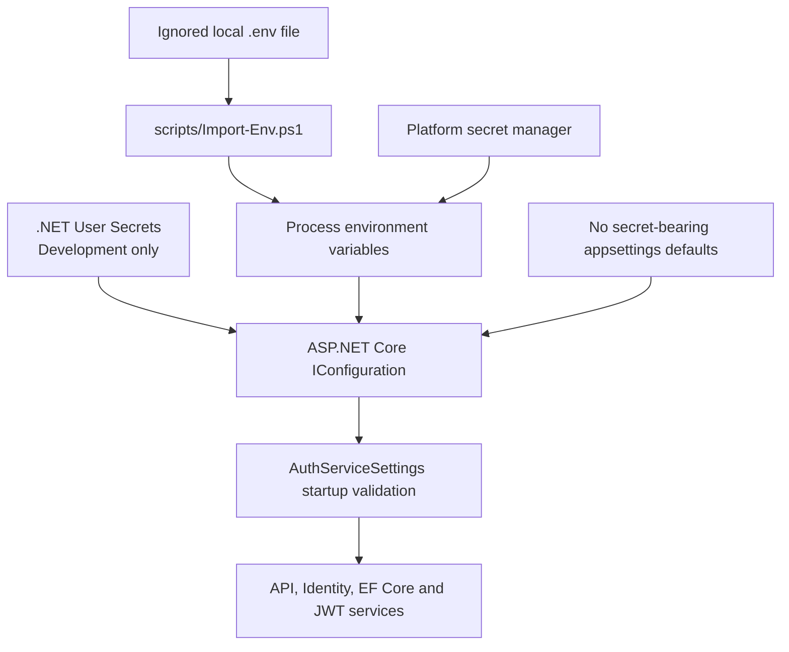

# Environment and Configuration Strategy

This document is the source of truth for runtime configuration in Auth Service.
The committed `.env*.example` files are templates, not secret-bearing
deployments. The ASP.NET Core application reads the standard .NET configuration
keys shown below; it does **not** load dotenv files automatically.

## Configuration architecture



Configuration precedence follows the ASP.NET Core WebApplication defaults:
environment variables override appsettings and User Secrets. The checked-in
appsettings files intentionally contain no application settings. Local secrets
can be supplied with `.NET User Secrets`; staging and production secrets must
come from the hosting platform's secret manager. The dotenv importer is for
local convenience only and sets values in its current PowerShell process.

Use the native ASP.NET Core keys (`ASPNETCORE_ENVIRONMENT`,
`ASPNETCORE_URLS`, and double-underscore nested configuration keys) rather
than introducing parallel `APP_*`, `DB_*`, or `JWT_*` aliases. This avoids a
custom mapping layer and duplicate sources of truth.

## Runtime environment variable reference

The following are the configuration variables currently consumed by the
application. “Required” means required for application startup unless noted.
Security levels: **Critical** means secret/credential; **High** means security
policy or externally reachable behavior; **Moderate** means operational
configuration; **Low** means non-sensitive metadata.

| Variable | Purpose | Type | Example | Required | Security | Default recommendation |
| --- | --- | --- | --- | --- | --- | --- |
| `ASPNETCORE_ENVIRONMENT` | Select ASP.NET Core environment and Swagger visibility. | String enum | `Development`, `Staging`, `Production` | No (framework defaults to `Production`) | Moderate | Set explicitly; `Development` only on a developer machine. |
| `ASPNETCORE_URLS` | Kestrel bind addresses and ports. | Semicolon-separated URLs | `http://localhost:5170` | No | High | Bind a local loopback address in development; bind the container interface behind a trusted TLS-terminating proxy in production. |
| `AllowedHosts` | ASP.NET Core host filtering allowlist. | Semicolon-separated host names | `localhost;127.0.0.1` | Yes | High | Explicit service hostnames; wildcard `*` is rejected in Production. |
| `ConnectionStrings__DefaultConnection` | SQL Server connection string used by EF Core and Identity. | SQL Server connection string | LocalDB string in `.env.development.example` | Yes | Critical | LocalDB for Windows development; managed SQL Server with encryption and least-privilege identity elsewhere. |
| `Jwt__SecretKey` | HMAC-SHA256 signing and validation key for access JWTs. | Secret string, at least 32 UTF-8 bytes | Injected random 32+ byte secret | Yes | Critical | Generate a unique cryptographically random secret; keep outside the repository and rotate deliberately. |
| `Jwt__Issuer` | JWT issuer claim and bearer validation issuer. | Non-empty string | `AuthService` | Yes | High | Stable, environment-specific identifier; match issuance and validation. |
| `Jwt__Audience` | JWT audience claim and bearer validation audience. | Non-empty string | `AuthService-Clients` | Yes | High | Restrict to intended clients and keep consistent across API and token consumers. |
| `Jwt__AccessTokenExpirationMinutes` | Access JWT lifetime and login response expiry. | Positive integer | `15` | Yes | High | Short lifetime appropriate to clients and risk; current samples use 15 minutes. |
| `Jwt__RefreshTokenExpirationDays` | Lifetime of persisted refresh-token records. | Positive integer | `7` | Yes | High | Use a limited lifetime aligned with session policy; current samples use 7 days. |
| `Identity__Password__RequireDigit` | Identity password digit requirement. | Boolean | `true` | Yes | High | `true`. |
| `Identity__Password__RequiredLength` | Identity minimum password length. | Integer from 8 to 100 | `8` | Yes | High | At least `8`; consider a longer passphrase-friendly limit after reviewing API DTO validation. |
| `Identity__Password__RequireNonAlphanumeric` | Identity special-character requirement. | Boolean | `false` | Yes | High | `false` is consistent with the current policy; request DTOs independently require one of a fixed special-character set. |
| `Identity__Password__RequireUppercase` | Identity uppercase-letter requirement. | Boolean | `true` | Yes | High | `true` to preserve current behavior. |
| `Identity__Password__RequireLowercase` | Identity lowercase-letter requirement. | Boolean | `true` | Yes | High | `true` to preserve current behavior. |
| `Identity__User__RequireUniqueEmail` | Require unique email addresses in Identity. | Boolean | `true` | Yes | High | `true`. |
| `Identity__SignIn__RequireConfirmedEmail` | Require confirmed email for sign-in. | Boolean | `false` | Yes | High | `true` only after implementing and testing email delivery/confirmation; current code has no email sender. |
| `Features__RegistrationEnabled` | Enable or hide the public registration route. | Boolean | `true` | No | High | Explicitly set per environment; consider `false` where account creation is controlled elsewhere. Missing value defaults to `true`. |
| `IpRateLimiting__EnableEndpointRateLimiting` | Enable endpoint-specific rate limits. | Boolean | `true` | Yes operationally | High | `true`. |
| `IpRateLimiting__StackBlockedRequests` | Count blocked requests toward limits. | Boolean | `false` | Yes operationally | Moderate | `false`, unless a reviewed policy requires otherwise. |
| `IpRateLimiting__RealIpHeader` | Header used by rate limiting for the client IP. | Header name | `X-Real-IP` | Yes operationally | High | Only trust a header overwritten by a known reverse proxy; do not accept client-supplied IP headers from the public internet. |
| `IpRateLimiting__ClientIdHeader` | Optional client identifier header read by the rate-limit package. | Header name | `X-ClientId` | Yes operationally | Moderate | Keep configured consistently with the package; do not treat a caller-controlled value as authentication. |
| `IpRateLimiting__HttpStatusCode` | Status returned when the limiter blocks a request. | HTTP status integer | `429` | Yes operationally | Moderate | `429`. |
| `IpRateLimiting__GeneralRules__0__Endpoint` | First rate-limit rule endpoint matcher. | String | `*` | Yes operationally | High | `*` for the global baseline. |
| `IpRateLimiting__GeneralRules__0__Period` | First rate-limit rule window. | AspNetCoreRateLimit period string | `1m` | Yes operationally | Moderate | Use a small, explicit window. |
| `IpRateLimiting__GeneralRules__0__Limit` | First rule maximum request count. | Positive integer | `60` | Yes operationally | High | Tune to expected traffic and abuse risk; monitor 429s. |
| `IpRateLimiting__GeneralRules__1__Endpoint` | Login-specific rate-limit matcher. | String | `POST:/api/auth/login` | Yes operationally | High | Keep a stricter rule for login. |
| `IpRateLimiting__GeneralRules__1__Period` | Login rule window. | AspNetCoreRateLimit period string | `1m` | Yes operationally | Moderate | `1m` is the current sample. |
| `IpRateLimiting__GeneralRules__1__Limit` | Maximum login requests in the window. | Positive integer | `5` | Yes operationally | High | Tune conservatively; this limiter is currently in-memory and per process. |
| `Serilog__MinimumLevel__Default` | Minimum application log event level. | Serilog level enum | `Information` | No | Moderate | `Information` in production; `Debug` only in local development. |
| `Serilog__MinimumLevel__Override__Microsoft` | Framework log level override. | Serilog level enum | `Warning` | No | Low | `Warning`. |
| `Serilog__MinimumLevel__Override__System` | System log level override. | Serilog level enum | `Warning` | No | Low | `Warning`. |
| `Logging__FilePath` | Optional rolling file sink path; if empty/omitted, console only. | File path | `logs/auth-service-.log` | No | Moderate | Omit in container/cloud environments and use standard output; use a managed persistent/logging sink where needed. |
| `Logging__FileRollingInterval` | Rolling interval when a file sink is enabled. | Serilog `RollingInterval` enum | `Day` | No | Low | `Day`; ignored when file logging is disabled. |

### .NET configuration shape

Double underscores map to nested `IConfiguration` keys. For example:

```text
Jwt__AccessTokenExpirationMinutes=15
```

is read as:

```csharp
configuration["Jwt:AccessTokenExpirationMinutes"]
```

AspNetCoreRateLimit arrays use numeric indexes:
`IpRateLimiting__GeneralRules__0__Endpoint`.

### Generic template variables and implementation status

Do not set values for the following generic names unless the application is
extended to consume them. They are intentionally **not** emitted as active
settings in the dotenv templates; an inert environment variable gives a false
sense that a capability is configured.

| Requested template name(s) | Status / canonical approach |
| --- | --- |
| `APP_NAME`, `APP_VERSION` | Assembly/project metadata; no runtime behavior depends on these. Add an explicit service-info option only if a consumer needs it. |
| `APP_ENV` | Use `ASPNETCORE_ENVIRONMENT`. |
| `APP_PORT`, `APP_HOST` | Use `ASPNETCORE_URLS`; it accepts one or more bind URLs. |
| `APP_DEBUG` | No independent debug switch. Use `ASPNETCORE_ENVIRONMENT` and log-level settings; never use a debug flag to expose production details. |
| `API_VERSION`, `API_PREFIX` | Fixed route contract `/api/auth`, not an environment setting. |
| `API_TIMEOUT` | No application-level outbound HTTP client exists to configure. |
| `API_RATE_LIMIT` | Not a single value: use the two explicit AspNetCoreRateLimit rule sets above. |
| `DB_TYPE`, `DB_HOST`, `DB_PORT`, `DB_NAME`, `DB_USER`, `DB_PASSWORD`, `DB_SSL` | EF Core is currently SQL Server-specific. Use one canonical `ConnectionStrings__DefaultConnection` to avoid ambiguous composition of credentials/options. |
| `JWT_SECRET` | Use `Jwt__SecretKey`. There is no separate refresh-token signing key: refresh tokens are opaque random values. |
| `JWT_EXPIRES_IN` | Use `Jwt__AccessTokenExpirationMinutes` as an integer number of minutes. |
| `REFRESH_TOKEN_SECRET` | Not applicable; refresh-token values are random and persisted. |
| `REFRESH_TOKEN_EXPIRES` | Use `Jwt__RefreshTokenExpirationDays` as an integer number of days. |
| `ENCRYPTION_KEY`, `SESSION_SECRET` | No application-level encryption key or server-side web session is implemented. Database/password hashing mechanisms have their own keys/configuration. |
| `CORS_ORIGINS` | CORS middleware/policies are not configured. Do not enable cross-origin access by adding an unused variable. |
| `CACHE_PROVIDER`, `REDIS_HOST`, `REDIS_PORT`, `REDIS_PASSWORD`, `CACHE_TTL` | No distributed cache exists. AspNetCoreRateLimit uses process-local in-memory storage. |
| `STORAGE_PROVIDER`, `UPLOAD_PATH`, `MAX_UPLOAD_SIZE` | No upload or object-storage functionality exists. |
| `SMTP_HOST`, `SMTP_PORT`, `SMTP_USER`, `SMTP_PASSWORD`, `SMTP_FROM` | No email sender exists. Email confirmation is currently disabled. |
| `LOG_LEVEL`, `LOG_FORMAT`, `LOG_PATH` | Use Serilog keys above. Structured JSON formatting is not explicitly configured; `LOG_FORMAT` is not consumed. |
| `METRICS_ENABLED`, `SENTRY_DSN`, `TRACING_ENABLED` | No metrics, Sentry, tracing, or health-check integration exists. |
| OpenAI, Azure OpenAI, Anthropic, Gemini variables | No AI/model integration exists. |
| AWS/Azure credentials and subscription variables | No cloud SDK or infrastructure deployment integration exists in the repository. Supply platform-specific credentials only if a future integration needs them. |
| `ENABLE_REGISTRATION` | Use `Features__RegistrationEnabled`. |
| `ENABLE_ANALYTICS`, `ENABLE_CACHE`, `ENABLE_EMAIL_NOTIFICATIONS` | No corresponding feature is implemented. |
| `DOCKER_IMAGE`, `K8S_NAMESPACE` | Build/release/deployment pipeline values, not application process configuration; no container or Kubernetes assets are present. |

## Duplicate and hard-coded configuration audit

### Corrected by the environment strategy

- The committed JWT example secret was removed from appsettings. The key is now
  required, and startup checks that it contains at least 32 UTF-8 bytes.
- JWT issuer, audience, secret, and token lifetimes are loaded once into
  `AuthServiceSettings`, shared by issuance and bearer validation.
- Access-token expiry previously appeared in both JWT generation and the login
  response; both now use `Jwt__AccessTokenExpirationMinutes`.
- The seven-day refresh-token lifetime previously appeared in two controller
  actions; both now use `Jwt__RefreshTokenExpirationDays`.
- Identity password/email settings were literals in `Program.cs`; they now use
  required environment-backed configuration keys.
- Database connection string, rate rules, log levels, and allowed hosts were
  previously embedded in JSON. `appsettings.json` is now empty; examples hold
  the non-secret environment-specific values.
- The rolling log path was a code literal. It is now optional
  `Logging__FilePath`, and the rolling interval can be selected by
  `Logging__FileRollingInterval`.
- The registration feature can be switched off with
  `Features__RegistrationEnabled`.
- Launch-profile ports were fixed in `launchSettings.json`; bind addresses and
  ports now come from `ASPNETCORE_URLS`.

### Deliberate code/policy constants

Not every literal belongs in environment configuration. These describe the API
contract, schema, or security algorithm and should not vary silently between
environments:

- `/api/auth` routes, HTTP verbs, DTO validation messages/shapes, and seeded
  role names (`Admin`, `User`, `Manager`).
- SQL Server provider selection and table/entity mappings. Supporting another
  DB provider requires a code/deployment architecture change, not a `DB_TYPE`
  toggle.
- JWT algorithm (HMAC-SHA256), random refresh-token generation, claims, and
  token algorithms. These are security protocol choices, not tunable values.
- Security response header policy and HSTS policy, which should be reviewed as
  code/security changes rather than weakened with deployment flags.
- Registration/password DTO annotations and regex. They are stricter than or
  overlap some Identity options. Consolidate these rules into a shared
  validation/policy implementation before allowing arbitrary environment
  overrides; otherwise an operator can configure Identity and API validation
  inconsistently.
- Framework/package versions and target framework in project files; these are
  build inputs, not runtime variables.
- API sample host address in `AuthService.API.http`; it is an editor request
  sample, not the server bind configuration.

## Startup validation

`AuthService.Infrastructure.Configuration.AuthServiceSettings.Load` validates
the required SQL connection string, JWT key, issuer/audience, positive token
lifetimes, allowed-host value, and Identity policy values before the host is
built. It rejects an empty signing key, a key shorter than 32 UTF-8 bytes,
non-positive/non-integer lifetimes, an empty host allowlist, and invalid
booleans with an explicit startup exception. Wildcard `*` host filtering is
rejected in Production. The optional registration flag defaults to enabled and
rejects values other than `true` or `false`. If file logging is enabled, the
program also validates the rolling interval name.

The validation is intentionally fail-fast: startup should not proceed with
authentication or data access configured with missing/invalid critical values.
It does not validate database connectivity or migrations; those are operational
readiness checks and should be added separately.

## Validation schema example

`.env` is a flat string map, so validate numeric and boolean types after parsing.
This JSON Schema illustrates the required application configuration shape (it
is a documentation example; it is not currently wired as a runtime validator):

```json
{
  "$schema": "https://json-schema.org/draft/2020-12/schema",
  "type": "object",
  "required": [
    "ConnectionStrings__DefaultConnection",
    "AllowedHosts",
    "Jwt__SecretKey",
    "Jwt__Issuer",
    "Jwt__Audience",
    "Jwt__AccessTokenExpirationMinutes",
    "Jwt__RefreshTokenExpirationDays",
    "Identity__Password__RequiredLength",
    "Identity__Password__RequireDigit",
    "Identity__Password__RequireNonAlphanumeric",
    "Identity__Password__RequireUppercase",
    "Identity__Password__RequireLowercase",
    "Identity__User__RequireUniqueEmail",
    "Identity__SignIn__RequireConfirmedEmail"
  ],
  "properties": {
    "ConnectionStrings__DefaultConnection": { "type": "string", "minLength": 1 },
    "Jwt__SecretKey": { "type": "string", "minLength": 32 },
    "Jwt__Issuer": { "type": "string", "minLength": 1 },
    "Jwt__Audience": { "type": "string", "minLength": 1 },
    "Jwt__AccessTokenExpirationMinutes": { "type": "string", "pattern": "^[1-9][0-9]*$" },
    "Jwt__RefreshTokenExpirationDays": { "type": "string", "pattern": "^[1-9][0-9]*$" },
    "Identity__Password__RequiredLength": { "type": "string", "pattern": "^[1-9][0-9]*$" },
    "Identity__Password__RequireDigit": { "type": "string", "enum": ["true", "false"] },
    "Identity__Password__RequireNonAlphanumeric": { "type": "string", "enum": ["true", "false"] },
    "Identity__Password__RequireUppercase": { "type": "string", "enum": ["true", "false"] },
    "Identity__Password__RequireLowercase": { "type": "string", "enum": ["true", "false"] },
    "Identity__User__RequireUniqueEmail": { "type": "string", "enum": ["true", "false"] },
    "Identity__SignIn__RequireConfirmedEmail": { "type": "string", "enum": ["true", "false"] },
    "Features__RegistrationEnabled": { "type": "string", "enum": ["true", "false"] },
    "AllowedHosts": { "type": "string", "minLength": 1 },
    "ASPNETCORE_URLS": { "type": "string", "minLength": 1 }
  },
  "additionalProperties": true
}
```

The application performs the authoritative startup checks. A schema `minLength`
counts Unicode characters, while the implementation checks the JWT key's UTF-8
byte length.

## Ignore rules and secret handling

The root `.gitignore` excludes local dotenv files while explicitly allowing the
four sanitized examples:

```gitignore
# Ignore real dotenv files; keep committed templates
.env
.env.*
!.env.example
!.env.development.example
!.env.staging.example
!.env.production.example
```

Never commit:

- JWT signing keys, database passwords/connection strings with credentials,
  SMTP/API keys, cloud credentials, access tokens, refresh tokens, or private
  certificates.
- Filled `.env`, `.env.development`, `.env.staging`, `.env.production`, local
  secrets, database backups, or logs containing personal data.

If a secret is committed, assume it is compromised: revoke/rotate it, inspect
history and access logs, and follow the incident process. Removing it in a later
commit does not remove it from Git history.

## Loading a local dotenv file (PowerShell)

Copy a template to an ignored local file, fill in local-only non-secret values,
then load it into the current shell:

```powershell
Copy-Item .env.development.example .env.development
.\scripts\Import-Env.ps1 .env.development
$rng = [System.Security.Cryptography.RandomNumberGenerator]::Create()
$keyBytes = New-Object byte[] 32
$rng.GetBytes($keyBytes)
$env:Jwt__SecretKey = [Convert]::ToBase64String($keyBytes)
$rng.Dispose()
dotnet run --project .\AuthService.API\AuthService.API.csproj --no-launch-profile
```

The importer accepts simple `KEY=VALUE` lines, ignores comments and blank
values, strips matching surrounding quotes, performs no shell expansion, and
does not print secret values. It is not a full Bash/Docker dotenv parser. For
repeatable local development, use .NET User Secrets instead:

```powershell
dotnet user-secrets init --project .\AuthService.API\AuthService.API.csproj
dotnet user-secrets set "Jwt:SecretKey" "<unique-random-secret-of-at-least-32-bytes>" --project .\AuthService.API\AuthService.API.csproj
```

The environment provider takes precedence over User Secrets. Do not leave an
empty `Jwt__SecretKey` value in the process environment when expecting the
User Secrets value to apply.

## Environment separation

| Environment | Configuration template | Secret source | Recommended policy |
| --- | --- | --- | --- |
| Development | `.env.development.example` | Developer process env or .NET User Secrets | LocalDB; Development Swagger; verbose logs only locally; never reuse production keys. |
| Testing | No dedicated template yet | CI secret store / ephemeral test configuration | Isolated disposable database and unique key per run. No test project currently consumes this environment. |
| Staging | `.env.staging.example` | Staging platform secret manager | Separate database, issuer/audience, signing key, and hostname from production; use production-like security with safe test data. |
| Production | `.env.production.example` | Production secret manager/workload identity | HTTPS at trusted ingress, explicit host allowlist, restricted database access, no public Swagger, console/centralized logs, reviewed migrations. |

The staging and production samples contain placeholder database hostnames and
intentionally omit secret values. They are documentation templates, not
deployable configurations. Set production settings through the platform's
configuration and secret-management facility.

## Architecture recommendations

1. Keep ASP.NET Core's native `IConfiguration` hierarchy as the canonical
   configuration API; avoid translating `DB_*`/`JWT_*` aliases.
2. Add strongly typed, options-validated sections for rate limiting and logging
   if configuration grows. Preserve fail-fast validation and include
   environment-specific policy checks (for example, reject wildcard hosts in
   Production).
3. Add database readiness checks and stop swallowing migration failures in
   startup. Run production migrations as an explicit release operation.
4. Replace in-memory rate-limit storage with a distributed store or gateway
   limit before horizontal scale-out.
5. Add explicit trusted proxy configuration before relying on forwarded IP or
   HTTPS headers.
6. Use platform identity/workload identity for database and cloud services
   where supported instead of long-lived passwords.
7. Keep `.env` solely as a developer convenience; production should inject
   environment/configuration directly from an orchestrator or secret store.
8. Separate deploy-time settings (image tag, namespace, replica count) from
   application runtime settings; manage them in pipeline/IaC, which this
   repository does not yet contain.

## Security recommendations

- Generate a distinct key per environment with a cryptographic random-number
  generator. Keep it outside source, shell history, build output, and logs.
- Use a secret manager with access controls, audit events, rotation, and
  recovery procedures. Grant applications only the secrets they need.
- Avoid credentials in connection strings when managed identity is available.
  Require encrypted SQL transport and validate certificates.
- Treat public-facing proxy headers and client-ID headers as untrusted unless a
  trusted edge proxy overwrites them.
- Do not place tokens, passwords, or personal data in logging variables or
  diagnostic output.
- Review every configuration change that can weaken identity, HTTPS, host
  filtering, rate limits, or token validation as a security change.
- Avoid one global shared key across Development, Staging, and Production.

## Updating the configuration contract

When adding a setting:

1. Use the existing `Section__Property` naming convention.
2. Decide whether it is actually environment-specific; keep API/security
   invariants in code when appropriate.
3. Add a typed parser/validator and a clear fail-fast error for required values.
4. Add safe values to the neutral and relevant environment example files; never
   add live secrets.
5. Update this reference and the README setup instructions.
6. Add tests for missing, malformed, and valid values.
7. Check that no duplicate JSON default or conflicting hard-coded runtime value
   remains.
